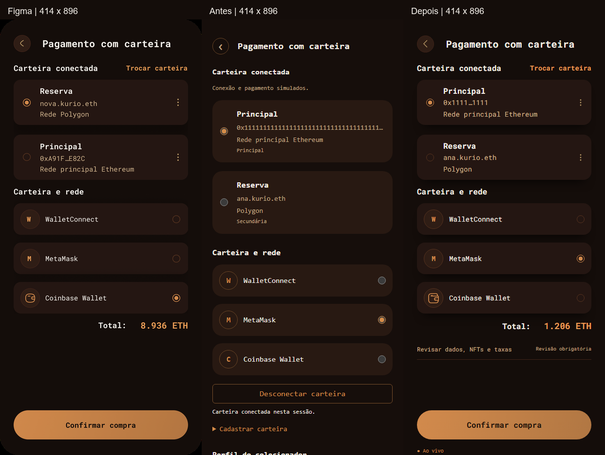

# Revisão visual 03 · Pagamento mobile

Referências: [Mobile / Pagamento](../../design-references/mobile/pagamento.png), [Desktop / Pagamento](../../design-references/desktop/pagamento.png) e [enunciado oficial](https://github.com/junglegaming/frontend-challenge). Escopo: apresentação do pagamento mobile; sem alteração dos contratos REST/MSW, regras financeiras, autenticação ou pedidos.

## Comparação visual

[Figma / Antes / Depois em 414 × 896](comparison-414.png)



O PNG original do Figma, 828 × 1792, foi reduzido exatamente a 414 × 896. As capturas da aplicação usam escala 1, Chromium e fontes locais carregadas (`document.fonts.ready`). Somente a referência foi redimensionada; as capturas da aplicação não foram recortadas nem retocadas. Cabeçalhos da montagem ficam fora das três imagens.

| Elemento em 414 × 896 | Antes | Depois |
| --- | --- | --- |
| Área útil | 370px, margem 22px | 358px, margem 28px |
| Cabeçalho | y=38, altura 34px | y=28, alvo de retorno 44px |
| Primeiro card | y=166, altura 128,3px | y=124, altura 93px |
| Segundo card | y=312,3 | y=237 |
| Provedores | y=504,1 / 585,1 / 666,1 | y=378 / 459 / 540 |
| Total REST | y=2119,1 | y=617 |
| Confirmar compra | y=2291,1, altura 54px | y=804, altura 60px |

Coordenadas extraídas do DOM em [antes](before-metrics.json) e [depois](after-metrics.json), com Ana, duas carteiras, uma unidade de Emerald Ape e conexão MetaMask. O total desse cenário é **1.206 ETH**; os 8.936 ETH, endereço e seleção ilustrativos do Figma não foram copiados. A ordem e o conteúdo dos cards continuam provenientes da API.

## Diagnóstico e apresentação progressiva

Antes, cards, conexão, cadastro de carteira, formulário completo, NFTs, taxas e aceite eram empilhados. O total e a confirmação ficavam muito abaixo do primeiro viewport. Uma carteira cadastrada/selecionada já era diferente de uma conexão efetiva, distinção mantida.

Agora aparecem diretamente retorno/título, estado da conexão, carteiras reais, gerenciamento, provedores, total e ação principal. Roboto Mono local reutiliza os mesmos arquivos 400/700 do cadastro/login. Cores ficam em tokens restritos ao pagamento até 600px; desktop e demais páginas conservam seus estilos. Cards usam as proporções do frame, radios nativos estilizados e ícones SVG do sistema existente. O arredondamento externo do dispositivo não foi aplicado à página.

**Revisar dados, NFTs e taxas** contém formulário completo, cadastro adicional de carteira, itens, subtotal, desconto, taxa, total, aceite e retorno ao carrinho/cupom. Com essa seção fechada, **Confirmar compra** apenas abre a revisão: mostra erros e foca o primeiro campo inválido; se todos forem válidos, foca o título do formulário. O envio definitivo continua exigindo conexão efetiva, cotação válida/atual, dados válidos e aceite explícito. Abrir ou fechar a revisão não aceita valores nem cria pedidos.

Dados do colecionador continuam usando o rascunho isolado por usuário ou os valores padrão da sessão já implementados. Nome de exibição, nome de usuário, nome do perfil e e-mail são obrigatórios; as mesmas validações cliente/servidor foram mantidas. Rede/endereço vêm da carteira selecionada. ENS, indicação e observação continuam opcionais e validados quando preenchidos. Não foi introduzida sincronização automática adicional com o perfil nem sobrescrito um rascunho.

Sem carteiras, o cadastro real existente fica aberto. Salvar uma carteira não a apresenta como conectada: a conexão simulada ainda precisa ser confirmada pela API. **Trocar carteira** executa a desconexão existente; os três pontos levam ao gerenciamento real de carteiras. Respostas de carregamento/falha e bloqueio de duplicatas permanecem nos hooks anteriores.

O botão fica no fluxo, com altura mínima da página e espaço flexível, sem sobrepor campos ou mensagens. Em alturas reduzidas e na revisão aberta, a página rola normalmente. O rodapé oculto nesse mobile continha apenas marca/textos informativos, sem links de navegação; voltar ao carrinho e gerenciamento permanecem disponíveis. Status Socket.IO e **Cenários de demonstração**, incluindo falhas, recuperação e reset, continuam acessíveis após a ação principal.

## Estados e preservação

| Evidência | Captura |
| --- | --- |
| Cenário padrão, conectado, 414 × 896 | [Depois](after-414.png) · [Antes](before-414.png) |
| Completo, com revisão inicialmente fechada | [Captura Playwright](pagamento-completo-mobile.png) |
| Carteiras cadastradas, sem conexão | [414 × 896](after-disconnected.png) |
| Conta nova sem carteira; cadastro aberto | [Página completa](pagamento-sem-carteira-mobile.png) |
| Campos inválidos e foco na correção | [Página completa, viewport 390 × 500](pagamento-dados-incompletos-mobile.png) |
| Mobile menor | [390 × 844](after-390.png) · [390 × 500](after-short.png) |
| Desktop, conteúdo completo | [Antes](before-desktop.png) · [Depois](after-desktop.png) |
| Tablet, conteúdo completo | [Antes](before-tablet.png) · [Depois](after-tablet.png) |

As capturas desktop (1440 × 1000) e tablet (768 × 1024), de página inteira, são **pixel a pixel idênticas** antes/depois no mesmo cenário. [Verificação](verification.json). Nenhuma captura inclui dados pessoais reais. Na captura longa com erros, o foco está no primeiro campo inválido; elementos fixos aparecem na posição do viewport durante a captura de página inteira.

**Baseline alterada individualmente:** somente `tests/e2e/checkout.spec.ts-snapshots/checkout-mobile-win32.png`. A imagem passou a mostrar os cards compactos e a revisão expandida usada pela jornada de compra existente, com fonte/cores/espaçamento novos e sem o rodapé informativo. Comparada ao frame e às capturas antes da atualização. O hash de todas as demais baselines foi preservado em relação ao início desta revisão, incluindo login, cadastro, desktop/tablet e recibos. O teste principal ainda verifica o recibo imutável e os valores da compra.

## Arquivos e testes

- `src/features/checkout/page.tsx`: apresentação mobile progressiva, foco/erros e ação em duas etapas; desktop mantém a organização anterior.
- `src/features/checkout/wallet-panel.tsx`: apresentação compacta, conexão/troca, gerenciamento e endereço abreviado com valor completo acessível.
- `src/features/checkout/quote-summary.tsx`: identificação opcional do total detalhado para distinguir os dois pontos de apresentação; conteúdo e valores preservados.
- `src/components/icon.tsx`: ícones locais de carteira e três pontos.
- `src/styles.css`: regras limitadas ao pagamento mobile; sem mudança da fonte global.
- `src/features/auth/assets/fonts/README.md`: documenta o novo uso da fonte existente; nenhum arquivo de fonte ou dependência foi adicionado.
- `tests/e2e/checkout-ui.ts`, `checkout.spec.ts`, `account.spec.ts`, `optimization.spec.ts`: acesso à revisão pela interface real e cenários adicionais, mantendo as asserções de negócio.
- `tests/e2e/auth.spec.ts`: somente título de teste ajustado para descrever o escopo tipográfico atual; asserções preservadas.
- `README.md`, `ARCHITECTURE.md`, esta pasta e a única baseline indicada acima completam a entrega. Arquivos já preparados das revisões de autenticação foram preservados.

Ambiente: Windows, Node **24.14.1**, Playwright **1.64.1**, Chromium **156.0.8078.4**. Build de demonstração servido por Vite preview; MSW e Socket.IO ativos. Fixtures e relógio determinísticos; sem endpoints privados, dependências adicionais ou Lighthouse.

| Validação | Resultado |
| --- | --- |
| `npm.cmd run typecheck` | Aprovado |
| `npm.cmd run lint` | Aprovado |
| `npm.cmd run build:demo` | Aprovado |
| `git diff --check` | Aprovado |
| Três cenários novos × três projetos | 9 aprovados, 39,1s |
| Jornada mobile e revisão da única baseline | 1 aprovado, 15,5s |
| Suíte completa, dois workers | **267 aprovados em 14,7 minutos**, sem falhas, skips ou retries |

Novos cenários cobrem perfil/carteira completos, ausência de carteira, correção acessível de quatro campos inválidos, conexão/troca/rede, aceite por teclado, cotação REST, Socket.IO com 18 casas ETH, compra pendente→confirmada e três dimensões mobile sem overflow. A regressão anterior continua cobrindo recusa, timeout, recuperação/idempotência, preço/estoque, snapshot imutável, sessão expirada e isolamento Ana/Bruno.

Comandos de reprodução (PowerShell, após `npm.cmd run build:demo`):

```powershell
$env:E2E_PREVIEW='true'
$env:PLAYWRIGHT_HTML_OUTPUT_DIR='playwright-report/visual-03-direcionados'
npx.cmd playwright test checkout.spec.ts --grep 'pagamento compacto|pagamento sem carteira|dados incompletos' --output=test-results/visual-03-direcionados
$env:PLAYWRIGHT_HTML_OUTPUT_DIR='playwright-report/visual-03-final'
npx.cmd playwright test --workers=2 --max-failures=1 --output=test-results/visual-03-final
npx.cmd playwright show-report playwright-report/visual-03-final
```

O relatório HTML final está em `playwright-report/visual-03-final/index.html`; esses relatórios completos e os traces são artefatos locais ignorados em `playwright-report/` e `test-results/`. As capturas selecionadas desta pasta são os arquivos preparados para o repositório. A execução final não teve falhas nem traces de falha. A primeira tentativa completa com três workers parou em um timeout do teste de cancelamento de busca do catálogo: 56 aprovados, 1 falha, 2 interrompidos e 208 não executados. O mesmo teste passou isoladamente em 5,6s sem alterar o catálogo. A execução completa foi repetida com dois workers, sem outro comando pesado em paralelo, e aprovou os 267 testes. Ensaios iniciais dos testes novos também corrigiram uma expectativa HTTP 201 para o 200 já existente e sincronização com respostas de login/desconexão, sem modificar contratos nem retirar asserções.

## Diferenças e limites

A revisão expansível obrigatória e o acesso à demonstração não aparecem no frame ilustrativo, mas mantêm os requisitos de compra e avaliação acessíveis. Carteiras, ordem, rede selecionada e total correspondem à fixture/API; não se reproduzem os exemplos estáticos do Figma. O estado sem conexão inclui uma ação de conexão e contas novas mostram cadastro, aumentando a altura por necessidade funcional.

Tipografia reutiliza a família confirmada nas revisões anteriores; dimensões e acabamento deste frame foram comparados ao PNG, sem novos valores CSS fornecidos pelo Figma. O ícone Coinbase é uma carteira vetorial do sistema existente, não uma integração de marca. Endereços longos ficam abreviados nos cards e completos no formulário/leitor de tela; ETH mantém todas as casas e pode quebrar linha. Teclado/touch foram verificados no Chromium; teclado virtual e safe areas em aparelhos físicos não foram testados. O desktop foi preservado e continua aguardando sua revisão visual própria. Nenhum commit, deploy ou alteração de negócio foi realizado.
