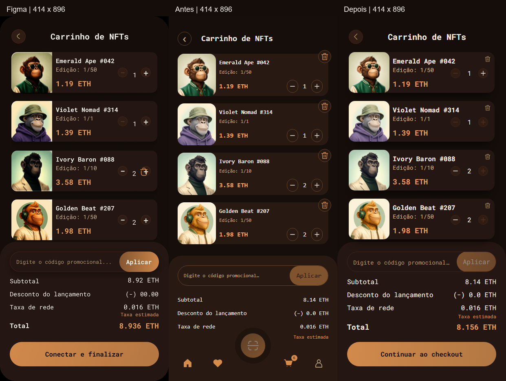

# Revisão visual 04 · Carrinho mobile

[Figma / Antes / Depois em 414 × 896](comparison-414.png)



O [PNG original](../../design-references/mobile/carrinho.png), 828 × 1792, foi normalizado para 414 × 896. Capturas da aplicação em escala 1, Chromium, build de demonstração/Vite preview, fontes carregadas e apenas dados fictícios. As imagens da aplicação não foram redimensionadas nem retocadas; os títulos da montagem ficam fora dos três viewports.

## Diagnóstico e resultado

Antes, título e textos ficavam menores que o frame, os controles tinham alvos estreitos, a remoção flutuava fora dos cards e a navegação fixa encobria o resumo. Um item na captura original não significava ausência de suporte a múltiplos itens.

Agora, somente o carrinho até 600px reutiliza Roboto Mono local e os tokens confirmados. Cabeçalho, cards de 100px com imagens quadradas, preço, quantidade, cupom e resumo seguem as proporções do frame. Conteúdo longo pode aumentar a altura, sem esticar a imagem nem sobrepor controles. Incremento/decremento/remoção possuem alvos de 44px; remover permanece visível em todos os itens, sem reproduzir a sobreposição ilustrativa do ícone no terceiro card do Figma.

No cenário de quatro itens, o primeiro card começa em **y=88**, o resumo em **y=554** e o CTA em **y=800**, com **60px** de altura. O painel mantém retorno ao mercado abaixo do CTA, acessível por rolagem. “Continuar ao checkout” foi preservado por descrever a navegação real: não conecta carteira nem confirma compra nessa tela. [Métricas anteriores](before-metrics.json) e [finais](after-metrics.json).

A navegação inferior fixa e o rodapé informativo ficam ocultos apenas no carrinho mobile. Nenhum link funcional foi removido do rodapé, que continha somente marca/textos. Voltar ao mercado, continuar explorando, detalhes dos NFTs e checkout permanecem acessíveis. Recomendações continuam abaixo do resumo; status Socket.IO e cenários/reset ficam após o conteúdo principal. A navegação inferior reaparece ao voltar ao mercado, comportamento coberto pelo teste de teclado. Altura reduzida usa rolagem normal, sem CTA fixo sobre o conteúdo.

## Cenário equivalente e integridade financeira

Foram usadas as quatro artes existentes: Emerald padrão ×1, Violet única ×1, Ivory limitada ×2 e Golden padrão ×2. A fixture original tem Golden esgotado e estoque limitado do Ivory igual a um. Somente nos contextos descartáveis de comparação/teste foi usada a reposição já existente:

```text
POST /api/__mock/nfts/ivory-baron-088/update
{ "editionId": "limited", "available": 2 }
POST /api/__mock/nfts/golden-beat-207/update
{ "editionId": "standard", "available": 2 }
```

Esses controles atualizam a fonte compartilhada e emitem eventos pelo Socket.IO existente; os testes verificam o recebimento. Os itens são adicionados por REST nos scripts de captura e pela interface de detalhe nos testes. Não houve alteração de fixtures, preços, contratos, handlers, cálculo decimal ou regras de estoque. O reset restaura o cenário original.

O subtotal REST é **8.14 ETH** e o total **8.156 ETH**, incluindo **0.016 ETH** de taxa. Os números ilustrativos 8.92/8.936 do Figma não foram copiados. Com `KURIO10`, desconto de 0.814 ETH é fornecido pela mesma cotação REST. Botões respeitam quantidade mínima, estoque e mutations pendentes.

## Capturas e impacto nas outras telas

| Estado | Evidência |
| --- | --- |
| Quatro itens, 414 × 896 | [Antes](before-four-414.png) · [Depois](after-four-414.png) · [Página inteira final](after-four-414-full.png) |
| Um item, 414 × 896 | [Antes](before-one-414.png) · [Depois](after-one-414.png) |
| Carrinho vazio | [414 × 896](after-empty.png) |
| 390 × 844 | [Início](after-four-390.png) · [Resumo alcançado por rolagem](after-four-390-summary.png) |
| 390 × 500 | [Início](after-short.png) · [Resumo alcançado por rolagem](after-short-summary.png) |
| Desktop, viewport 1440 × 1000 | [Antes](before-desktop.png) · [Depois](after-desktop.png) |
| Tablet, viewport 768 × 1024 | [Antes](before-tablet.png) · [Depois](after-tablet.png) |

Desktop e tablet ficaram **pixel a pixel idênticos** antes/depois no cenário equivalente. [Verificação](verification.json). Cadastro, login e pagamento não receberam alterações de componentes ou regras; suas baselines foram preservadas.

**Única baseline atualizada:** `tests/e2e/cart.spec.ts-snapshots/cart-mobile-win32.png`. Justificativa: fonte/cores, cabeçalho, dimensões e controles dos cards, resumo e navegação mobile mudaram conforme a comparação acima. A baseline existente usa três itens; o cenário com quatro possui capturas próprias. Nenhuma baseline foi atualizada na regressão completa.

## Arquivos e validação

- `src/features/cart/page.tsx`: ícone de retorno reutilizado; hooks, REST e lógica do carrinho intactos.
- `src/styles.css`: regras condicionadas ao carrinho mobile; nenhuma fonte ou navegação global substituída.
- `tests/e2e/cart.spec.ts`: dois cenários novos e adaptação do helper de login ao retorno real pelo mercado quando a navegação do carrinho está oculta; asserções anteriores mantidas.
- `src/features/auth/assets/fonts/README.md`: registra o uso dos mesmos arquivos locais, sem dependência ou fonte nova.
- `README.md`, esta pasta e a baseline acima: documentação e evidências.

Typecheck, lint, `build:demo` e `git diff --check` aprovados. **12 testes direcionados passaram em 1,2 minuto**: carrinho com quatro itens, cupom, quantidade, três dimensões mobile, chegada ao pagamento com autenticação/merge, nome longo, ETH de 18 casas, remoção/estado vazio, teclado e isolamento. A comparação individual da baseline mobile passou em **13,8s**.

A primeira rodada direcionada teve 11 aprovados e uma leitura antes de terminar a rolagem suave. Foi mantida a verificação de visibilidade completa e ausência de sobreposição, aguardando-a com `expect.poll`; uma inspeção isolada confirmou a posição final dos controles. Não foi necessário mudar a rolagem da aplicação nem retirar asserções.

A primeira rodada completa, com dois workers, parou com 218 aprovados, 1 falha, 1 interrompido e 53 não executados: o teste mobile de resposta privada atrasada terminou no mercado após logout/login e verificou o estado vazio sem retornar ao carrinho. Foi acrescentado o clique real de volta ao carrinho, mantendo as asserções de resposta atrasada e proprietário Bruno. O teste isolado passou em 13s, sem alteração adicional da aplicação. A suíte completa foi iniciada novamente com os três workers da configuração local padrão, sem comandos pesados concorrentes.

**Suíte completa: 273 aprovados em 11,5 minutos**, com três workers, sem falhas, skips ou retries na execução final. A regressão inclui carrinho/cupom, autenticação, perfil/carteiras, responsividade, checkout, pedidos, recuperação, precisão ETH e eventos Socket.IO. A conferência SHA-256 após a execução confirmou somente a baseline mobile do carrinho alterada; todas as demais permaneceram iguais às do início desta revisão.

Reprodução (PowerShell):

```powershell
npm.cmd run typecheck
npm.cmd run lint
npm.cmd run build:demo
$env:E2E_PREVIEW='true'
$env:PLAYWRIGHT_HTML_OUTPUT_DIR='playwright-report/visual-04-direcionados'
npx.cmd playwright test cart.spec.ts --workers=2 --grep 'quatro NFTs|um item com nome longo|merge no login|isolamento entre Ana' --output=test-results/visual-04-direcionados
$env:PLAYWRIGHT_HTML_OUTPUT_DIR='playwright-report/visual-04-final'
npx.cmd playwright test --workers=3 --max-failures=1 --output=test-results/visual-04-final
```

Relatórios HTML completos permanecem locais em `playwright-report/visual-04-direcionados/index.html` e `playwright-report/visual-04-final/index.html`, ignorados pelo Git. Esta pasta contém somente capturas selecionadas, métricas, comparação e relatório.

## Diferenças remanescentes

Artes e recortes dos assets da API diferem de algumas miniaturas do frame; foram reutilizados sem substituir dados ou usar capturas como implementação. Estoque real desabilita aumentos quando necessário; Aplicar fica inativo com código vazio. Formatação e valores vêm da API, incluindo ETH no desconto. Remoção, retorno ao mercado, recomendações e ferramentas continuam acessíveis, mesmo ausentes do frame ilustrativo. O arredondamento externo do dispositivo não foi aplicado à página. Teclado/touch emulado foram verificados no Chromium; teclado virtual e áreas seguras em aparelhos físicos não foram testados. Nenhum commit, push, deploy ou Lighthouse.
